# PharmaGest — Dossier de conception

Application web de gestion de pharmacie développée avec Django 6.1 (Python), SQLite en développement et PostgreSQL recommandé en production.

**Sommaire**

1. [Contexte et périmètre](#1-contexte-et-périmètre)
2. [Acteurs et rôles](#2-acteurs-et-rôles)
3. [Règles de gestion](#3-règles-de-gestion)
4. [Modèle conceptuel de données (MCD)](#4-modèle-conceptuel-de-données-mcd)
5. [Modèle logique de données (MLD)](#5-modèle-logique-de-données-mld)
6. [Dictionnaire des données](#6-dictionnaire-des-données)
7. [Diagrammes UML](#7-diagrammes-uml)
8. [Architecture technique](#8-architecture-technique)
9. [Sécurité et intégrité](#9-sécurité-et-intégrité)

Les diagrammes sont dans `docs/diagrammes/` aux formats PNG (lecture) et SVG (impression sans perte). Leurs sources modifiables sont dans `docs/diagrammes/sources/` : Graphviz (`.dot`) et Mermaid (`.mmd`).

---

## 1. Contexte et périmètre

PharmaGest couvre l'activité quotidienne d'une officine :

| Module | Contenu |
|---|---|
| A — Authentification | Connexion, rôles, journal d'audit des opérations sensibles |
| B, C — Médicaments | Catalogue avec photo, catégories, archivage, recherche, tri, pagination |
| D — Fournisseurs | Fiche, historique des commandes et des montants reçus |
| E — Clients | Fiche, historique des achats |
| F — Achats | Commande (brouillon → commandée → réception partielle ou totale), annulation |
| G — Stock | Lots avec date de péremption, sortie FEFO, mouvements tracés, alertes, inventaire physique, blocage de lot |
| H — Ventes | Caisse avec scan du code-barres, paiements (espèces, mobile money, carte, chèque) |
| I — Retours | Retour partiel ou total, annulation compensatoire |
| J — Tableau de bord | Indicateurs du jour et de la période |
| K — Documents PDF | Reçu, facture, bon de commande, bon de réception, rapports de stock, ventes, achats, péremptions |

**Choix structurant : le stock n'est jamais saisi à la main.** Il se calcule à partir des lots (`stock_lotstock.quantite`), et chaque variation passe par un seul service (`stock.services.enregistrer_mouvement`), qui écrit une ligne de `stock_mouvementstock` avec le stock avant et après.

## 2. Acteurs et rôles

Les rôles sont des groupes Django (`auth_group`). Un utilisateur peut en cumuler plusieurs ; le super-administrateur Django a tous les droits.

| Fonction | Administrateur | Pharmacien responsable | Gestionnaire de stock | Caissier | Responsable de gestion |
|---|:-:|:-:|:-:|:-:|:-:|
| Comptes, rôles, journal d'audit | ✔ | | | | |
| Médicaments et catégories (création, modification) | ✔ | ✔ | | | |
| Supprimer (médicament, client, fournisseur) | ✔ | | | | |
| Consulter le catalogue | ✔ | ✔ | ✔ | ✔ | ✔ |
| Fournisseurs (gestion) | ✔ | ✔ | ✔ | | consultation |
| Clients (gestion) | ✔ | ✔ | | ✔ | consultation |
| Commandes et réceptions | ✔ | ✔ | ✔ | | consultation |
| État du stock | ✔ | ✔ | ✔ | ✔ | ✔ |
| Alertes et mouvements | ✔ | ✔ | ✔ | | ✔ |
| Corrections et inventaire | ✔ | ✔ | ✔ | | |
| Bloquer un lot | ✔ | ✔ | | | |
| Caisse, retours, vérification des paiements | ✔ | ✔ | | ✔ | |
| Annuler une vente | ✔ | ✔ | | | |
| Historique des ventes | ✔ | ✔ | | ✔ | ✔ |
| Page des rapports, PDF des ventes | ✔ | ✔ | | | ✔ |
| PDF de stock, d'achats et de péremptions | ✔ | ✔ | ✔ | | ✔ |

Le contrôle se fait côté serveur par le décorateur `@role_requis(...)` (`utilisateurs/permissions.py`) placé sur chaque vue ; le menu masque en plus les liens inaccessibles.

## 3. Règles de gestion

| Réf. | Règle | Mise en œuvre |
|---|---|---|
| RG01 | Chaque enregistrement a un identifiant unique | Clé primaire auto-incrémentée `id` |
| RG02 | Un code-barres est unique ; plusieurs médicaments peuvent ne pas en avoir | `UNIQUE` sur `code_barres`, valeur vide convertie en `NULL` |
| RG03 | Toute saisie est validée côté serveur (quantités > 0, prix > 0, prix de vente ≥ prix d'achat, téléphone, image) | Formulaires Django et services |
| RG04 | Une commande ne modifie pas le stock | Seule la réception crée des mouvements d'entrée |
| RG05 | Une réception n'est enregistrée qu'une fois | Jeton unique de formulaire (`achats_receptionachat.jeton UNIQUE`) |
| RG06 | Une vente n'est enregistrée qu'une fois | Jeton unique de caisse (`ventes_vente.jeton UNIQUE`) |
| RG07 | Le stock n'est jamais négatif | `UPDATE … WHERE quantite >= n` + type `INTEGER ≥ 0` |
| RG08 | Un lot périmé ou bloqué n'est jamais vendu | Filtre `LotStock.objects.vendables()` + contrôle dans `valider_vente` |
| RG09 | Chaque opération garde son auteur, sa date et son historique | `stock_mouvementstock`, `utilisateurs_journalaudit`, champs `cree_par`, `valide_par`… |
| RG10 | Aucune suppression sans trace | Annulations et retours compensatoires ; `ON DELETE PROTECT` ; archivage au lieu de suppression |
| RG11 | L'accès dépend du rôle | `@role_requis` sur chaque vue |
| RG12 | Le prix d'une vente passée ne change pas | Prix et coût recopiés dans `ventes_lignevente` |
| RG13 | Sortie des lots selon FEFO (premier périmé, premier sorti) | Tri par `date_peremption` dans `_repartir_fefo` |
| RG14 | Un paiement électronique n'est encaissé qu'après vérification | Statut `EN_ATTENTE` → `CONFIRME` avec référence de transaction |

## 4. Modèle conceptuel de données (MCD)

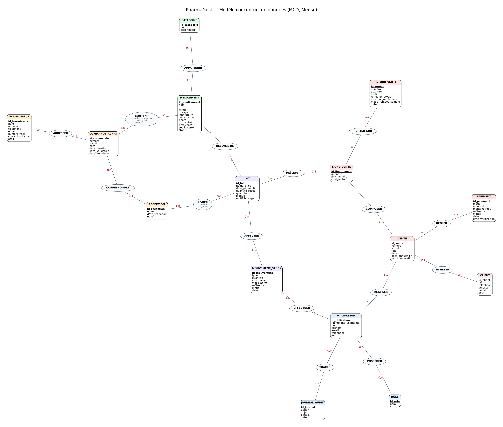

**Lecture des cardinalités** (notation Merise, *minimum,maximum* côté entité) :

| Association | Entités et cardinalités | Signification |
|---|---|---|
| APPARTENIR | MÉDICAMENT (1,1) — CATÉGORIE (0,n) | Un médicament appartient à une seule catégorie ; une catégorie regroupe zéro ou plusieurs médicaments |
| RELEVER_DE | LOT (1,1) — MÉDICAMENT (0,n) | Un lot concerne un seul médicament ; un médicament peut n'avoir aucun lot (jamais approvisionné) |
| ADRESSER | COMMANDE_ACHAT (1,1) — FOURNISSEUR (0,n) | Une commande est adressée à un seul fournisseur |
| CONTENIR | COMMANDE_ACHAT (1,n) — MÉDICAMENT (0,n) | Association porteuse : quantité commandée, prix d'achat, quantité déjà reçue. Un médicament n'apparaît qu'une fois par commande |
| CORRESPONDRE | RÉCEPTION (1,1) — COMMANDE_ACHAT (0,n) | Une commande peut être reçue en plusieurs livraisons |
| LIVRER | RÉCEPTION (1,n) — LOT (0,n) | Association porteuse : quantité et prix reçus par lot |
| AFFECTER | MOUVEMENT_STOCK (1,1) — LOT (0,n) | Chaque entrée ou sortie concerne un lot précis |
| EFFECTUER | MOUVEMENT_STOCK (1,1) — UTILISATEUR (0,n) | Auteur de chaque mouvement (RG09) |
| RÉALISER | VENTE (1,1) — UTILISATEUR (0,n) | Le vendeur |
| ACHETER | VENTE (0,1) — CLIENT (0,n) | Une vente au comptoir peut être anonyme |
| COMPOSER | LIGNE_VENTE (1,1) — VENTE (1,n) | Une vente contient au moins une ligne |
| PRÉLEVER | LIGNE_VENTE (1,1) — LOT (0,n) | Chaque ligne sort d'un lot précis (une quantité répartie sur deux lots donne deux lignes) |
| RÉGLER | PAIEMENT (1,1) — VENTE (1,n) | Paiement de la vente |
| PORTER_SUR | RETOUR_VENTE (1,1) — LIGNE_VENTE (0,n) | Un retour vise une ligne précise, éventuellement en plusieurs fois |
| POSSÉDER | UTILISATEUR (0,n) — RÔLE (0,n) | Cumul de rôles possible |
| TRACER | JOURNAL_AUDIT (0,1) — UTILISATEUR (0,n) | Une tentative de connexion échouée n'a pas d'auteur connu |

**Choix de modélisation**

- LIGNE_VENTE est une entité et non une association porteuse, parce que les retours doivent la désigner (association PORTER_SUR).
- Pour la même raison, l'association CONTENIR devient la table `achats_ligneachat` avec un identifiant propre, référencé par `achats_lignereception`.
- Les auteurs secondaires (créé par, validé par, annulé par, reçu par, vérifié par, enregistré par) sont des associations (0,1)–(0,n) vers UTILISATEUR. Elles ne sont pas dessinées pour garder le schéma lisible, mais figurent dans le MLD.
- `ventes_lignevente.medicament_id` duplique volontairement l'information portée par le lot, pour accélérer les statistiques par médicament.

## 5. Modèle logique de données (MLD)

**Règles de passage appliquées**

1. Chaque entité devient une table ; son identifiant devient la clé primaire `id`.
2. Une association (1,1)–(0,n) disparaît : la table du côté (1,1) reçoit une clé étrangère vers l'autre table.
3. Une association (0,n)–(0,n) ou (1,n)–(0,n) devient une table dont la clé combine les deux clés étrangères (`achats_ligneachat`, `achats_lignereception`, `utilisateurs_utilisateur_groups`). Django ajoute un identifiant technique `id` et une contrainte `UNIQUE` sur le couple.
4. Les propriétés des associations porteuses deviennent des colonnes de la table d'association.

**Schéma relationnel** (notation : <u>clé primaire</u>, #clé étrangère) :

- **utilisateurs_utilisateur** (<u>id</u>, password, last_login, is_superuser, username, first_name, last_name, email, is_staff, is_active, date_joined, telephone)
- **utilisateurs_journalaudit** (<u>id</u>, action, objet, details, date, #utilisateur_id)
- **medicaments_categorie** (<u>id</u>, nom, description)
- **medicaments_medicament** (<u>id</u>, nom, dci, forme, dosage, laboratoire, code_barres, photo, prix_achat, prix_vente, seuil_alerte, statut, date_creation, #categorie_id, #cree_par_id)
- **fournisseurs_fournisseur** (<u>id</u>, nom, adresse, telephone, email, numero_fiscal, contact_principal, actif, date_creation, #cree_par_id)
- **clients_client** (<u>id</u>, nom, telephone, adresse, email, actif, date_creation, #cree_par_id)
- **achats_commandeachat** (<u>id</u>, numero, statut, note, date_creation, date_validation, date_annulation, #annule_par_id, #cree_par_id, #fournisseur_id, #valide_par_id)
- **achats_ligneachat** (<u>id</u>, quantite_commandee, prix_achat, quantite_recue, #commande_id, #medicament_id)
- **achats_receptionachat** (<u>id</u>, numero, date_reception, note, jeton, #commande_id, #recu_par_id)
- **achats_lignereception** (<u>id</u>, quantite, prix_achat, #ligne_achat_id, #lot_id, #reception_id)
- **stock_lotstock** (<u>id</u>, numero_lot, date_peremption, quantite_recue, quantite, bloque, motif_blocage, date_creation, #medicament_id)
- **stock_mouvementstock** (<u>id</u>, type, quantite, stock_avant, stock_apres, reference, motif, date, #lot_id, #utilisateur_id)
- **ventes_vente** (<u>id</u>, numero, statut, total, date, jeton, date_annulation, motif_annulation, #annule_par_id, #client_id, #vendeur_id)
- **ventes_lignevente** (<u>id</u>, quantite, prix_unitaire, cout_unitaire, #lot_id, #medicament_id, #vente_id)
- **ventes_paiement** (<u>id</u>, mode, montant, montant_recu, reference, statut, date, date_verification, #enregistre_par_id, #verifie_par_id, #vente_id)
- **ventes_retourvente** (<u>id</u>, numero, quantite, motif, remis_en_stock, montant_rembourse, mode_remboursement, date, #ligne_id, #utilisateur_id, #vente_id)
- **auth_group** (<u>id</u>, name)
- **utilisateurs_utilisateur_groups** (<u>id</u>, #utilisateur_id, #group_id)

**Contraintes d'unicité métier**

- `medicaments_medicament.code_barres` (NULL autorisé plusieurs fois), `medicaments_categorie.nom`, `fournisseurs_fournisseur.nom`
- `(achats_ligneachat.commande_id, medicament_id)` : un médicament une seule fois par commande
- `(stock_lotstock.medicament_id, numero_lot)` : un numéro de lot unique par médicament
- `numero` des commandes, réceptions, ventes et retours ; `jeton` des réceptions et ventes (anti double envoi)

**Politique de suppression des clés étrangères**

- `PROTECT` sur tout ce qui porte un historique (médicament, lot, vente, commande, utilisateur auteur…) : la base refuse la suppression, et l'application archive ou désactive à la place.
- `CASCADE` uniquement pour les lignes d'un document (`lignes` d'une commande, d'une réception, d'une vente).
- `SET NULL` pour les auteurs « créé par » et le journal d'audit.

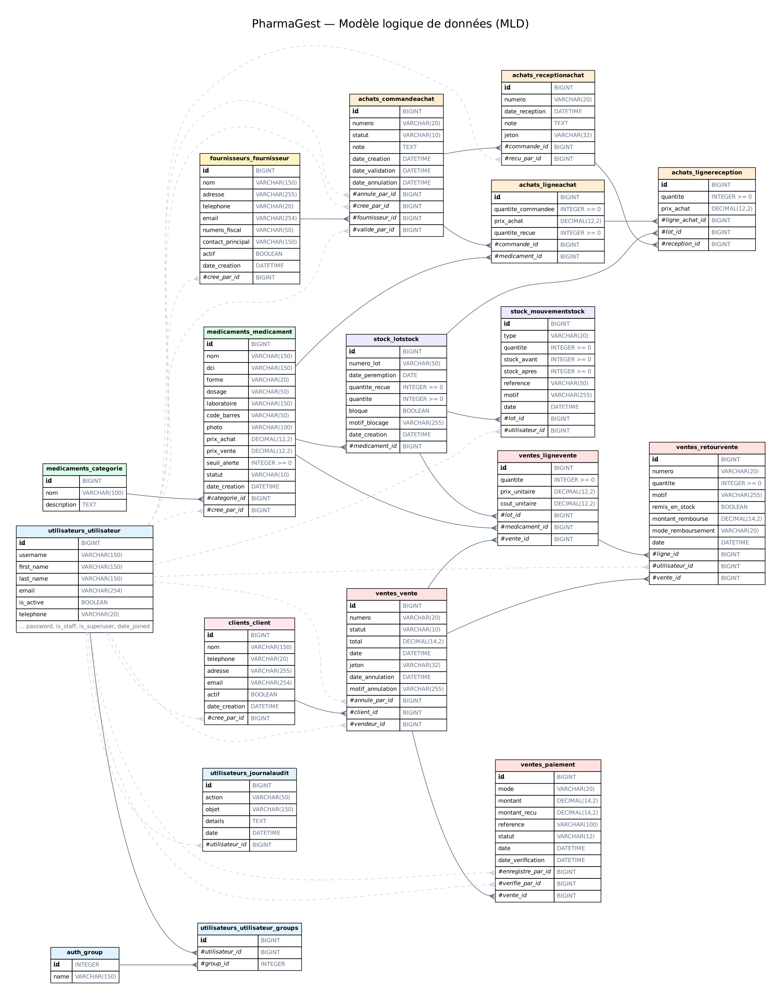

## 6. Dictionnaire des données

Types indiqués de façon générique ; le type exact dépend du moteur (SQLite ou PostgreSQL). Les tables techniques de Django (`django_session`, `django_migrations`, `auth_permission`, `django_admin_log`, `django_content_type`) ne sont pas détaillées.

#### utilisateurs_utilisateur  
*Modèle Django : `utilisateurs.Utilisateur`*

| Colonne | Type | Contraintes |
|---|---|---|
| `id` | BIGINT | PK |
| `password` | VARCHAR(128) | NOT NULL |
| `last_login` | DATETIME | NULL |
| `is_superuser` | BOOLEAN | NOT NULL |
| `username` | VARCHAR(150) | NOT NULL; UNIQUE |
| `first_name` | VARCHAR(150) | NOT NULL |
| `last_name` | VARCHAR(150) | NOT NULL |
| `email` | VARCHAR(254) | NOT NULL |
| `is_staff` | BOOLEAN | NOT NULL |
| `is_active` | BOOLEAN | NOT NULL |
| `date_joined` | DATETIME | NOT NULL |
| `telephone` | VARCHAR(20) | NOT NULL |

#### utilisateurs_journalaudit  
*Modèle Django : `utilisateurs.JournalAudit`*

| Colonne | Type | Contraintes |
|---|---|---|
| `id` | BIGINT | PK |
| `action` | VARCHAR(50) | NOT NULL |
| `objet` | VARCHAR(150) | NOT NULL |
| `details` | TEXT | NOT NULL |
| `date` | DATETIME | NOT NULL |
| `utilisateur_id` | BIGINT | NULL; FK → utilisateurs_utilisateur.id; ON DELETE SET_NULL |

#### medicaments_categorie  
*Modèle Django : `medicaments.Categorie`*

| Colonne | Type | Contraintes |
|---|---|---|
| `id` | BIGINT | PK |
| `nom` | VARCHAR(100) | NOT NULL; UNIQUE |
| `description` | TEXT | NOT NULL |

#### medicaments_medicament  
*Modèle Django : `medicaments.Medicament`*

| Colonne | Type | Contraintes |
|---|---|---|
| `id` | BIGINT | PK |
| `nom` | VARCHAR(150) | NOT NULL |
| `dci` | VARCHAR(150) | NOT NULL |
| `forme` | VARCHAR(20) | NOT NULL; liste : COMPRIME, GELULE, SIROP, INJECTABLE, POMMADE, SUPPOSITOIRE, COLLYRE, AUTRE |
| `dosage` | VARCHAR(50) | NOT NULL |
| `laboratoire` | VARCHAR(150) | NOT NULL |
| `code_barres` | VARCHAR(50) | NULL; UNIQUE |
| `photo` | VARCHAR(100) | NULL |
| `prix_achat` | DECIMAL(12,2) | NOT NULL |
| `prix_vente` | DECIMAL(12,2) | NOT NULL |
| `seuil_alerte` | INTEGER ≥ 0 | NOT NULL |
| `statut` | VARCHAR(10) | NOT NULL; liste : ACTIF, ARCHIVE |
| `date_creation` | DATETIME | NOT NULL |
| `categorie_id` | BIGINT | NOT NULL; FK → medicaments_categorie.id; ON DELETE PROTECT |
| `cree_par_id` | BIGINT | NULL; FK → utilisateurs_utilisateur.id; ON DELETE SET_NULL |

#### fournisseurs_fournisseur  
*Modèle Django : `fournisseurs.Fournisseur`*

| Colonne | Type | Contraintes |
|---|---|---|
| `id` | BIGINT | PK |
| `nom` | VARCHAR(150) | NOT NULL; UNIQUE |
| `adresse` | VARCHAR(255) | NOT NULL |
| `telephone` | VARCHAR(20) | NOT NULL |
| `email` | VARCHAR(254) | NOT NULL |
| `numero_fiscal` | VARCHAR(50) | NOT NULL |
| `contact_principal` | VARCHAR(150) | NOT NULL |
| `actif` | BOOLEAN | NOT NULL |
| `date_creation` | DATETIME | NOT NULL |
| `cree_par_id` | BIGINT | NULL; FK → utilisateurs_utilisateur.id; ON DELETE SET_NULL |

#### clients_client  
*Modèle Django : `clients.Client`*

| Colonne | Type | Contraintes |
|---|---|---|
| `id` | BIGINT | PK |
| `nom` | VARCHAR(150) | NOT NULL |
| `telephone` | VARCHAR(20) | NOT NULL |
| `adresse` | VARCHAR(255) | NOT NULL |
| `email` | VARCHAR(254) | NOT NULL |
| `actif` | BOOLEAN | NOT NULL |
| `date_creation` | DATETIME | NOT NULL |
| `cree_par_id` | BIGINT | NULL; FK → utilisateurs_utilisateur.id; ON DELETE SET_NULL |

#### achats_commandeachat  
*Modèle Django : `achats.CommandeAchat`*

| Colonne | Type | Contraintes |
|---|---|---|
| `id` | BIGINT | PK |
| `numero` | VARCHAR(20) | NULL; UNIQUE |
| `statut` | VARCHAR(10) | NOT NULL; liste : BROUILLON, COMMANDEE, PARTIELLE, RECUE, ANNULEE |
| `note` | TEXT | NOT NULL |
| `date_creation` | DATETIME | NOT NULL |
| `date_validation` | DATETIME | NULL |
| `date_annulation` | DATETIME | NULL |
| `annule_par_id` | BIGINT | NULL; FK → utilisateurs_utilisateur.id; ON DELETE PROTECT |
| `cree_par_id` | BIGINT | NOT NULL; FK → utilisateurs_utilisateur.id; ON DELETE PROTECT |
| `fournisseur_id` | BIGINT | NOT NULL; FK → fournisseurs_fournisseur.id; ON DELETE PROTECT |
| `valide_par_id` | BIGINT | NULL; FK → utilisateurs_utilisateur.id; ON DELETE PROTECT |

#### achats_ligneachat  
*Modèle Django : `achats.LigneAchat`*

| Colonne | Type | Contraintes |
|---|---|---|
| `id` | BIGINT | PK |
| `quantite_commandee` | INTEGER ≥ 0 | NOT NULL |
| `prix_achat` | DECIMAL(12,2) | NOT NULL |
| `quantite_recue` | INTEGER ≥ 0 | NOT NULL |
| `commande_id` | BIGINT | NOT NULL; FK → achats_commandeachat.id; ON DELETE CASCADE |
| `medicament_id` | BIGINT | NOT NULL; FK → medicaments_medicament.id; ON DELETE PROTECT |
| *contrainte* | | UNIQUE 'commande', 'medicament' — 'ligne_achat_unique' |

#### achats_receptionachat  
*Modèle Django : `achats.ReceptionAchat`*

| Colonne | Type | Contraintes |
|---|---|---|
| `id` | BIGINT | PK |
| `numero` | VARCHAR(20) | NULL; UNIQUE |
| `date_reception` | DATETIME | NOT NULL |
| `note` | TEXT | NOT NULL |
| `jeton` | VARCHAR(32) | NOT NULL; UNIQUE |
| `commande_id` | BIGINT | NOT NULL; FK → achats_commandeachat.id; ON DELETE PROTECT |
| `recu_par_id` | BIGINT | NOT NULL; FK → utilisateurs_utilisateur.id; ON DELETE PROTECT |

#### achats_lignereception  
*Modèle Django : `achats.LigneReception`*

| Colonne | Type | Contraintes |
|---|---|---|
| `id` | BIGINT | PK |
| `quantite` | INTEGER ≥ 0 | NOT NULL |
| `prix_achat` | DECIMAL(12,2) | NOT NULL |
| `ligne_achat_id` | BIGINT | NOT NULL; FK → achats_ligneachat.id; ON DELETE PROTECT |
| `lot_id` | BIGINT | NOT NULL; FK → stock_lotstock.id; ON DELETE PROTECT |
| `reception_id` | BIGINT | NOT NULL; FK → achats_receptionachat.id; ON DELETE CASCADE |

#### stock_lotstock  
*Modèle Django : `stock.LotStock`*

| Colonne | Type | Contraintes |
|---|---|---|
| `id` | BIGINT | PK |
| `numero_lot` | VARCHAR(50) | NOT NULL |
| `date_peremption` | DATE | NOT NULL |
| `quantite_recue` | INTEGER ≥ 0 | NOT NULL |
| `quantite` | INTEGER ≥ 0 | NOT NULL |
| `bloque` | BOOLEAN | NOT NULL |
| `motif_blocage` | VARCHAR(255) | NOT NULL |
| `date_creation` | DATETIME | NOT NULL |
| `medicament_id` | BIGINT | NOT NULL; FK → medicaments_medicament.id; ON DELETE PROTECT |
| *contrainte* | | UNIQUE 'medicament', 'numero_lot' — 'lot_unique_par_medicament' |

#### stock_mouvementstock  
*Modèle Django : `stock.MouvementStock`*

| Colonne | Type | Contraintes |
|---|---|---|
| `id` | BIGINT | PK |
| `type` | VARCHAR(20) | NOT NULL; liste : ENTREE_ACHAT, RETOUR_CLIENT, CORRECTION_PLUS, SORTIE_VENTE, CORRECTION_MOINS, SORTIE_PERTE |
| `quantite` | INTEGER ≥ 0 | NOT NULL |
| `stock_avant` | INTEGER ≥ 0 | NOT NULL |
| `stock_apres` | INTEGER ≥ 0 | NOT NULL |
| `reference` | VARCHAR(50) | NOT NULL |
| `motif` | VARCHAR(255) | NOT NULL |
| `date` | DATETIME | NOT NULL |
| `lot_id` | BIGINT | NOT NULL; FK → stock_lotstock.id; ON DELETE PROTECT |
| `utilisateur_id` | BIGINT | NOT NULL; FK → utilisateurs_utilisateur.id; ON DELETE PROTECT |

#### ventes_vente  
*Modèle Django : `ventes.Vente`*

| Colonne | Type | Contraintes |
|---|---|---|
| `id` | BIGINT | PK |
| `numero` | VARCHAR(20) | NULL; UNIQUE |
| `statut` | VARCHAR(10) | NOT NULL; liste : VALIDEE, ANNULEE |
| `total` | DECIMAL(14,2) | NOT NULL |
| `date` | DATETIME | NOT NULL |
| `jeton` | VARCHAR(32) | NOT NULL; UNIQUE |
| `date_annulation` | DATETIME | NULL |
| `motif_annulation` | VARCHAR(255) | NOT NULL |
| `annule_par_id` | BIGINT | NULL; FK → utilisateurs_utilisateur.id; ON DELETE PROTECT |
| `client_id` | BIGINT | NULL; FK → clients_client.id; ON DELETE PROTECT |
| `vendeur_id` | BIGINT | NOT NULL; FK → utilisateurs_utilisateur.id; ON DELETE PROTECT |

#### ventes_lignevente  
*Modèle Django : `ventes.LigneVente`*

| Colonne | Type | Contraintes |
|---|---|---|
| `id` | BIGINT | PK |
| `quantite` | INTEGER ≥ 0 | NOT NULL |
| `prix_unitaire` | DECIMAL(12,2) | NOT NULL |
| `cout_unitaire` | DECIMAL(12,2) | NOT NULL |
| `lot_id` | BIGINT | NOT NULL; FK → stock_lotstock.id; ON DELETE PROTECT |
| `medicament_id` | BIGINT | NOT NULL; FK → medicaments_medicament.id; ON DELETE PROTECT |
| `vente_id` | BIGINT | NOT NULL; FK → ventes_vente.id; ON DELETE CASCADE |

#### ventes_paiement  
*Modèle Django : `ventes.Paiement`*

| Colonne | Type | Contraintes |
|---|---|---|
| `id` | BIGINT | PK |
| `mode` | VARCHAR(20) | NOT NULL; liste : ESPECES, MOBILE_MONEY, CARTE, CHEQUE |
| `montant` | DECIMAL(14,2) | NOT NULL |
| `montant_recu` | DECIMAL(14,2) | NULL |
| `reference` | VARCHAR(100) | NOT NULL |
| `statut` | VARCHAR(12) | NOT NULL; liste : CONFIRME, EN_ATTENTE, REJETE |
| `date` | DATETIME | NOT NULL |
| `date_verification` | DATETIME | NULL |
| `enregistre_par_id` | BIGINT | NOT NULL; FK → utilisateurs_utilisateur.id; ON DELETE PROTECT |
| `verifie_par_id` | BIGINT | NULL; FK → utilisateurs_utilisateur.id; ON DELETE PROTECT |
| `vente_id` | BIGINT | NOT NULL; FK → ventes_vente.id; ON DELETE PROTECT |

#### ventes_retourvente  
*Modèle Django : `ventes.RetourVente`*

| Colonne | Type | Contraintes |
|---|---|---|
| `id` | BIGINT | PK |
| `numero` | VARCHAR(20) | NULL; UNIQUE |
| `quantite` | INTEGER ≥ 0 | NOT NULL |
| `motif` | VARCHAR(255) | NOT NULL |
| `remis_en_stock` | BOOLEAN | NOT NULL |
| `montant_rembourse` | DECIMAL(14,2) | NOT NULL |
| `mode_remboursement` | VARCHAR(20) | NOT NULL; liste : ESPECES, MOBILE_MONEY, CARTE, CHEQUE |
| `date` | DATETIME | NOT NULL |
| `ligne_id` | BIGINT | NOT NULL; FK → ventes_lignevente.id; ON DELETE PROTECT |
| `utilisateur_id` | BIGINT | NOT NULL; FK → utilisateurs_utilisateur.id; ON DELETE PROTECT |
| `vente_id` | BIGINT | NOT NULL; FK → ventes_vente.id; ON DELETE PROTECT |

#### auth_group  
*Modèle Django : `auth.Group (rôle)`*

| Colonne | Type | Contraintes |
|---|---|---|
| `id` | INTEGER | PK |
| `name` | VARCHAR(150) | NOT NULL; UNIQUE |

#### utilisateurs_utilisateur_groups  
*Modèle Django : `utilisateurs.Utilisateur ↔ Groupe`*

| Colonne | Type | Contraintes |
|---|---|---|
| `id` | BIGINT | PK |
| `utilisateur_id` | BIGINT | NOT NULL; FK → utilisateurs_utilisateur.id; ON DELETE CASCADE |
| `group_id` | INTEGER | NOT NULL; FK → auth_group.id; ON DELETE CASCADE |
| *contrainte* | | UNIQUE utilisateur_id, group_id |

## 7. Diagrammes UML

### 7.1 Diagrammes de cas d'utilisation

Découpés par domaine pour rester lisibles.

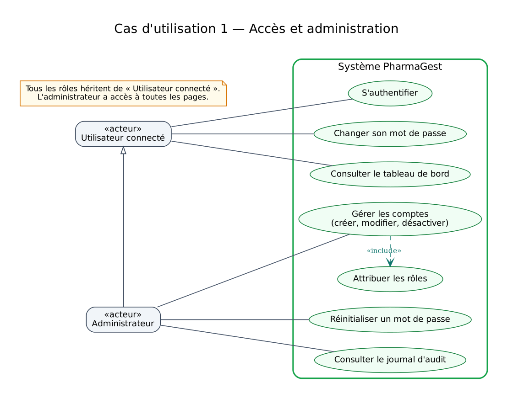

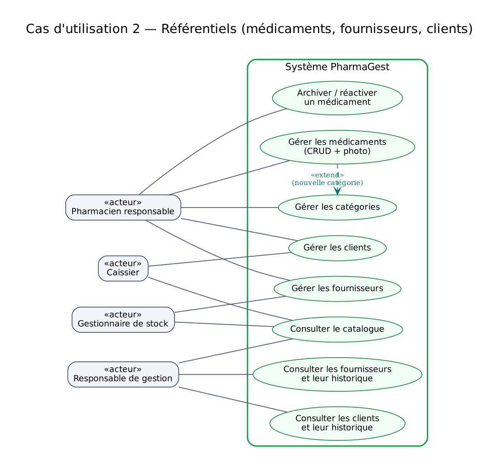

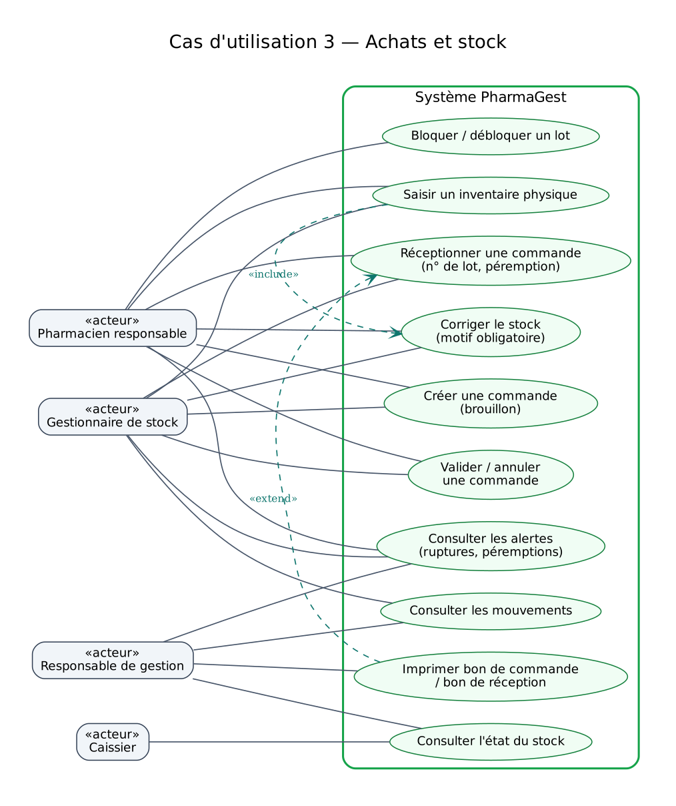

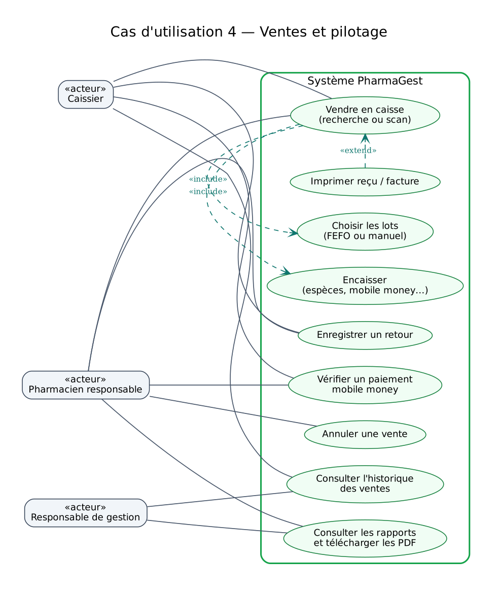

### 7.2 Diagramme de classes

Classes métier (modèles Django) avec leurs attributs principaux et les propriétés calculées. Les losanges pleins indiquent une composition : les lignes n'existent pas sans leur document.

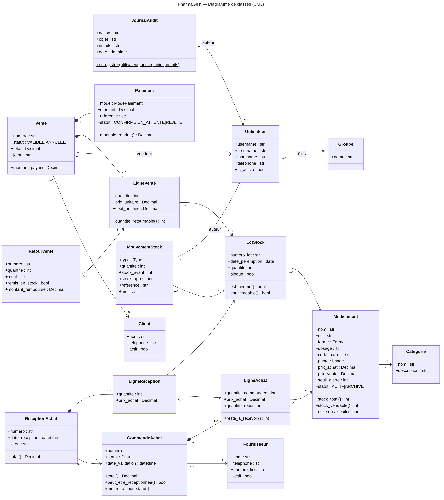

### 7.3 Diagrammes de séquence

**Vente en caisse.** Toute la vente se déroule dans une seule transaction : si un lot n'a plus assez de stock au moment de la validation, rien n'est enregistré (ni vente, ni mouvement, ni paiement).

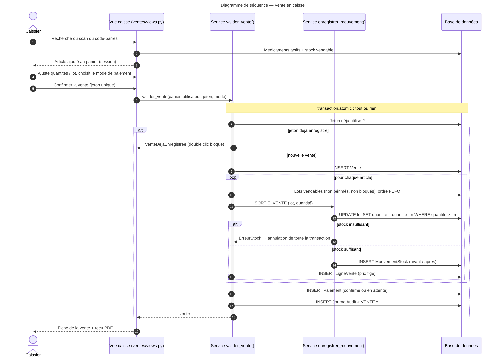

**Commande puis réception.** Le stock n'augmente qu'à la réception, lot par lot.

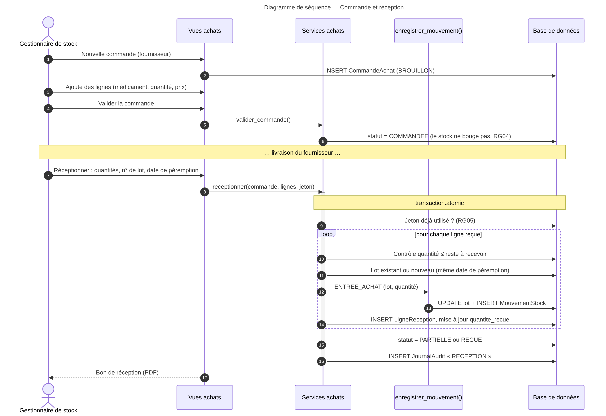

### 7.4 Diagrammes d'états

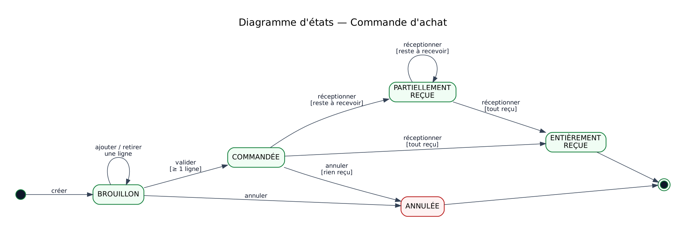

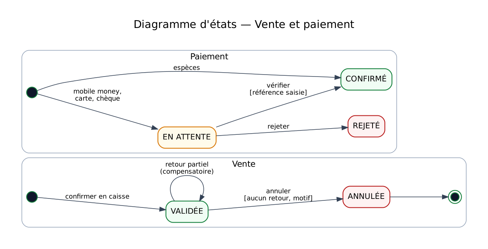

## 8. Architecture technique

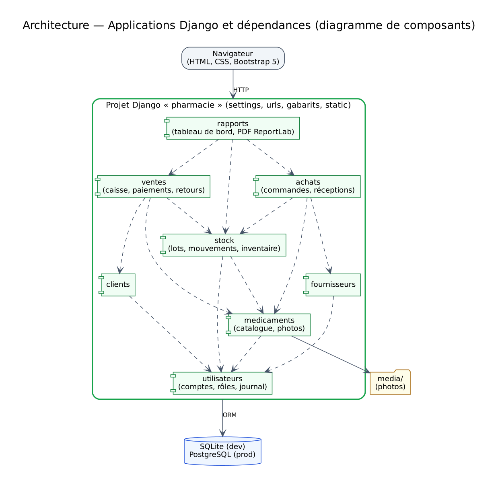

| Couche | Rôle | Fichiers |
|---|---|---|
| Présentation | Gabarits Django, Bootstrap 5, thème `static/css/style.css` | `templates/`, `static/` |
| Contrôle | Vues fonctionnelles protégées par rôle, formulaires | `*/views.py`, `*/forms.py`, `*/urls.py` |
| Métier | Services transactionnels (stock, achats, ventes) | `*/services.py` |
| Données | Modèles ORM et migrations | `*/models.py`, `*/migrations/` |
| Documents | Génération PDF avec ReportLab | `rapports/pdf.py` |
| Exploitation | Commandes de gestion | `utilisateurs/management/commands/` (`init_roles`, `donnees_demo`, `sauvegarder`, `restaurer`) |

Les vues ne modifient jamais le stock directement : elles appellent les services, qui sont les seuls à écrire dans `stock_lotstock` et `stock_mouvementstock`. Cette séparation rend les règles testables sans navigateur (voir `*/tests.py`).

## 9. Sécurité et intégrité

- Mots de passe hachés (PBKDF2, Django), règles de complexité activées, changement et réinitialisation par l'administrateur.
- Protection CSRF sur tous les formulaires, toutes les actions qui modifient des données en `POST`.
- Clé secrète, mode debug et noms d'hôte lus depuis des variables d'environnement ; cookies sécurisés et HSTS quand le debug est désactivé.
- Photos : 2 Mo maximum, formats JPEG, PNG ou WEBP vérifiés en ouvrant réellement l'image (Pillow).
- Transactions atomiques et mises à jour conditionnelles pour les opérations de stock ; base SQLite en mode `IMMEDIATE`.
- Journal d'audit : connexions (réussies et échouées), créations, modifications, validations, réceptions, ventes, annulations, retours, corrections, blocages.
- Sauvegarde vérifiée de la base et des photos (`python manage.py sauvegarder`), restauration avec copie de sécurité préalable.
